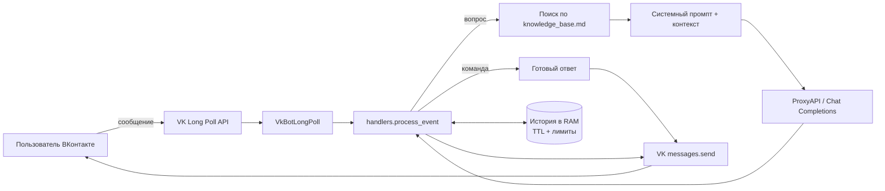

# Алина — AI-консультант сообщества ВКонтакте

[](https://github.com/ekhokhlova1970/alina-vk-ai-consultant/actions/workflows/ci.yml)
[](https://www.python.org/downloads/)
[](LICENSE)
[](https://github.com/astral-sh/ruff)

**Алина** — продающий, но не навязчивый AI-консультант для сообщества онлайн-университета
**Zerocoder** во ВКонтакте. Бот отвечает на вопросы о программах и форматах обучения,
подбирает направление под цель пользователя, опирается только на локальную базу знаний
и честно передаёт сложные вопросы менеджеру.

> Учебный проект курса Zerocoder, доведённый до состояния портфолио: пакетная структура,
> 75 автоматических тестов, CI на трёх версиях Python, Docker и документация.

---

## Содержание

- [Возможности](#возможности)
- [Пример диалога](#пример-диалога)
- [Архитектура](#архитектура)
- [Стек](#стек)
- [Быстрый старт](#быстрый-старт)
- [Запуск в Docker](#запуск-в-docker)
- [Переменные окружения](#переменные-окружения)
- [Команды бота](#команды-бота)
- [Как это работает](#как-это-работает)
- [Структура проекта](#структура-проекта)
- [Качество кода и тесты](#качество-кода-и-тесты)
- [Безопасность](#безопасность)
- [Ветки и релизы](#ветки-и-релизы)
- [Roadmap](#roadmap)
- [Лицензия](#лицензия)

---

## Возможности

| Возможность | Реализация |
| --- | --- |
| Приём сообщений сообщества | VK Bot Long Poll API (`vk_api`) |
| Генерация ответов | OpenAI-совместимый Chat Completions через **ProxyAPI** (`gpt-4o-mini` по умолчанию) |
| Ответы по фактам, а не по памяти модели | Локальная Markdown-база знаний, поиск релевантных разделов по запросу |
| Роль и стиль консультанта | Отдельный системный промпт `prompts/alina_system_prompt.md` |
| Контекст разговора | История в оперативной памяти: лимит сообщений, TTL, ограничение числа пользователей |
| Команды | `/start`, `/help`, `/reset`, `/contact` |
| Личные сообщения и беседы | Определение `peer_id` и корректная отправка в оба типа чатов |
| Длинные ответы | Автоматическая разбивка на несколько сообщений ВКонтакте |
| Устойчивость | Таймауты, retry в OpenAI SDK, fallback-ответ, переподключение Long Poll |
| Секреты | Только через `.env`, файл исключён из Git; ключи не попадают в логи и `repr` |
| Приватность | Переписка не пишется на диск, тексты сообщений не логируются |

## Пример диалога

```text
Пользователь: Здравствуйте! Хочу научиться делать ботов, но не программист.

Алина: Здравствуйте! Отличная цель. В Zerocoder есть программа
       «Вайб-кодер»: за 5 месяцев вы учитесь создавать ботов, парсеров
       и ИИ-агентов и автоматизировать задачи. Обучение построено
       на практике — к финалу у вас будет портфолио из нескольких решений.

       Подскажите, вам важнее освоить профессию с нуля или добавить
       навык к текущей работе? Так я смогу точнее сравнить варианты.

Пользователь: /contact

Алина: Я помогу подготовить вопрос для отдела продаж и уточнить условия
       выбранной программы.

       Оставьте заявку через форму:
       https://example.com/lead-form
```

Если в базе знаний нет подтверждённого ответа, Алина не придумывает цену,
даты или условия, а предлагает уточнить их у менеджера.

## Архитектура



Подробнее о компонентах и принятых решениях — [`docs/ARCHITECTURE.md`](docs/ARCHITECTURE.md).

## Стек

- **Python 3.10+** — без тяжёлых фреймворков, только стандартная библиотека и три зависимости.
- **vk_api** — Long Poll и отправка сообщений.
- **openai** — официальный SDK, направленный на OpenAI-совместимый эндпоинт ProxyAPI.
- **python-dotenv** — конфигурация через `.env`.
- **pytest** — 75 тестов без сетевых вызовов.
- **Ruff** — линтер и форматирование.
- **GitHub Actions** — CI на Python 3.10, 3.11, 3.12.
- **Docker** — воспроизводимый запуск.

## Быстрый старт

### 1. Клонировать и установить

```bash
git clone https://github.com/ekhokhlova1970/alina-vk-ai-consultant.git
cd alina-vk-ai-consultant
python -m venv .venv
source .venv/bin/activate        # Windows: .\.venv\Scripts\Activate.ps1
python -m pip install --upgrade pip
pip install -e ".[dev]"
```

### 2. Создать `.env`

```bash
cp .env.example .env             # Windows: Copy-Item .env.example .env
```

Заполнить как минимум `PROXY_API_KEY`, `VK_TOKEN` и `VK_GROUP_ID`.
Остальные переменные уже имеют безопасные значения по умолчанию.

### 3. Подготовить сообщество ВКонтакте

1. Управление сообществом → **Работа с API** → включить **Long Poll API**.
2. Создать ключ доступа сообщества с правами на сообщения.
3. Разрешить сообщения сообщества и ответы от имени сообщества.

Пошаговая инструкция с деталями — [`docs/SETUP.md`](docs/SETUP.md).

### 4. Запустить

```bash
alina-bot
# или
python -m alina_bot
```

При успешном старте в логе появятся модель, число фрагментов базы знаний
и сообщение о подключении к ВКонтакте. Остановка — `Ctrl+C`.

## Запуск в Docker

```bash
docker build -t alina-bot .
docker run --rm --env-file .env alina-bot
```

Образ работает от непривилегированного пользователя, а `.env` в него не копируется —
секреты передаются только во время запуска.

## Переменные окружения

| Переменная | Обязательна | По умолчанию | Назначение |
| --- | --- | --- | --- |
| `PROXY_API_KEY` | да | — | Ключ ProxyAPI, используется как Bearer-токен |
| `VK_TOKEN` | да | — | Токен сообщества ВКонтакте (алиас: `VK_ACCESS_TOKEN`) |
| `VK_GROUP_ID` | да | — | Числовой ID сообщества; минус отбрасывается |
| `OPENAI_MODEL` | нет | `gpt-4o-mini` | Модель, доступная в ProxyAPI |
| `LEAD_FORM_URL` | нет | пусто | Ссылка на форму отдела продаж |
| `LOG_LEVEL` | нет | `INFO` | `INFO`, `WARNING`, `ERROR`, `DEBUG` |
| `MAX_REPLY_TOKENS` | нет | `700` | Лимит токенов ответа (100–4096) |
| `MAX_HISTORY_MESSAGES` | нет | `12` | Глубина истории диалога (2–40) |
| `HISTORY_TTL_SECONDS` | нет | `3600` | Время жизни истории в памяти (60–86400) |
| `REQUEST_TIMEOUT_SECONDS` | нет | `30` | Таймаут запроса к ProxyAPI (5–120) |
| `KNOWLEDGE_BASE_PATH` | нет | `data/knowledge_base.md` | Путь к Markdown-базе знаний |

Все значения проверяются при старте: при ошибке бот пишет понятную причину
и завершается с кодом `1`, не пытаясь работать с неверной конфигурацией.

## Команды бота

| Команда | Действие |
| --- | --- |
| `/start` | Очистить историю и начать консультацию |
| `/help` | Показать возможности и список команд |
| `/reset` | Удалить историю диалога из памяти |
| `/contact` | Рассказать, как связаться с отделом продаж |

Команды понимаются и с упоминанием бота: `/start@alina_bot`.

## Как это работает

1. `VkBotLongPoll` получает события сообщества и отбрасывает всё, кроме новых входящих сообщений.
2. Сообщения самого сообщества (`out: 1`) и пустой текст игнорируются.
3. Команды обрабатываются без обращения к модели; `/start` и `/reset` очищают историю.
4. Для вопроса база знаний разбивается на разделы по Markdown-заголовкам, токенизируется
   с учётом синонимов и выбирает обзорный раздел плюс до четырёх релевантных.
5. Системное сообщение собирается из промпта Алины, ссылки на форму и найденного контекста.
6. История пользователя добавляется к запросу, ответ модели отправляется через `messages.send`.
7. Длинные ответы делятся по границам слов и абзацев; ошибки API не раскрывают детали пользователю.

## Структура проекта

```text
alina-vk-ai-consultant/
├── .github/workflows/ci.yml    # линтер и тесты на Python 3.10–3.12
├── data/
│   └── knowledge_base.md       # база знаний: программы, форматы, контакты
├── docs/
│   ├── ARCHITECTURE.md         # компоненты, поток запроса, компромиссы
│   ├── BRANCHING.md            # модель веток и соглашения о коммитах
│   └── SETUP.md                # настройка VK, ProxyAPI, деплой
├── prompts/
│   └── alina_system_prompt.md  # роль, стиль, ограничения и защита промпта
├── src/alina_bot/
│   ├── __init__.py
│   ├── __main__.py             # python -m alina_bot
│   ├── app.py                  # запуск, логирование, цикл Long Poll
│   ├── config.py               # чтение и валидация .env
│   ├── handlers.py             # обработка одного события
│   ├── history.py              # история диалогов в памяти
│   ├── knowledge.py            # разбиение и поиск по базе знаний
│   ├── llm.py                  # клиент ProxyAPI
│   └── messages.py             # команды, тексты, отправка в VK
├── tests/                      # 75 тестов без сети
├── .dockerignore
├── .env.example                # шаблон без секретов
├── .gitignore
├── CHANGELOG.md
├── Dockerfile
├── LICENSE
├── pyproject.toml
├── README.md
└── requirements.txt
```

## Качество кода и тесты

```bash
pytest                  # 75 тестов
ruff check src tests    # линтер
ruff format --check .   # форматирование
```

Тесты не ходят в сеть и не требуют токенов: VK API, ProxyAPI и время подменяются
фейками. Покрыты валидация конфигурации, поиск по базе знаний, история с TTL,
разбор команд, разбивка длинных сообщений и полный сценарий обработки события,
включая ошибки модели и VK.

CI (`.github/workflows/ci.yml`) запускается на каждый push и pull request
в `main` и `develop`.

## Безопасность

- `.env` исключён из Git; в репозитории лежит только `.env.example` без значений.
- Ключи хранятся в `Settings` с `repr=False` и никогда не логируются.
- Тексты сообщений пользователей не попадают в логи — только тип ошибки.
- История диалога живёт только в памяти процесса и ограничена по глубине, времени и числу пользователей.
- Ошибка ProxyAPI не раскрывает пользователю внутренние детали и не показывает ключ.
- Системный промпт запрещает раскрывать инструкции, ключи и внутренние настройки,
  а также сопротивляться попыткам сменить роль бота.

При компрометации ключа перевыпустите его в кабинете ProxyAPI или в настройках сообщества ВКонтакте.

## Ветки и релизы

Используется упрощённая модель Git Flow:

- `main` — только стабильные релизы, каждый отмечен тегом `vX.Y.Z`;
- `develop` — интеграционная ветка;
- `feature/*`, `fix/*`, `docs/*`, `chore/*` — рабочие ветки от `develop`;
- слияние в `develop` — через `--no-ff`, релиз — merge `develop → main` и тег.

Соглашения о коммитах (Conventional Commits), порядок релиза и примеры команд —
[`docs/BRANCHING.md`](docs/BRANCHING.md). История версий — [`CHANGELOG.md`](CHANGELOG.md).

## Roadmap

- [ ] Хранение истории в Redis, чтобы переживать перезапуск
- [ ] Эмбеддинги вместо токенного поиска по базе знаний
- [ ] Метрики: число диалогов, доля эскалаций менеджеру
- [ ] Ограничение частоты запросов на пользователя
- [ ] Ответы на изображения и голосовые сообщения
- [ ] Тесты с записью реальных ответов модели (VCR)

## Лицензия

Проект распространяется по лицензии [MIT](LICENSE).

Автор: **Елена Хохлова** · [GitHub](https://github.com/ekhokhlova1970)

> База знаний и системный промпт носят демонстрационный характер и не являются
> публичной офертой. Актуальные условия программ уточняйте у Zerocoder.
