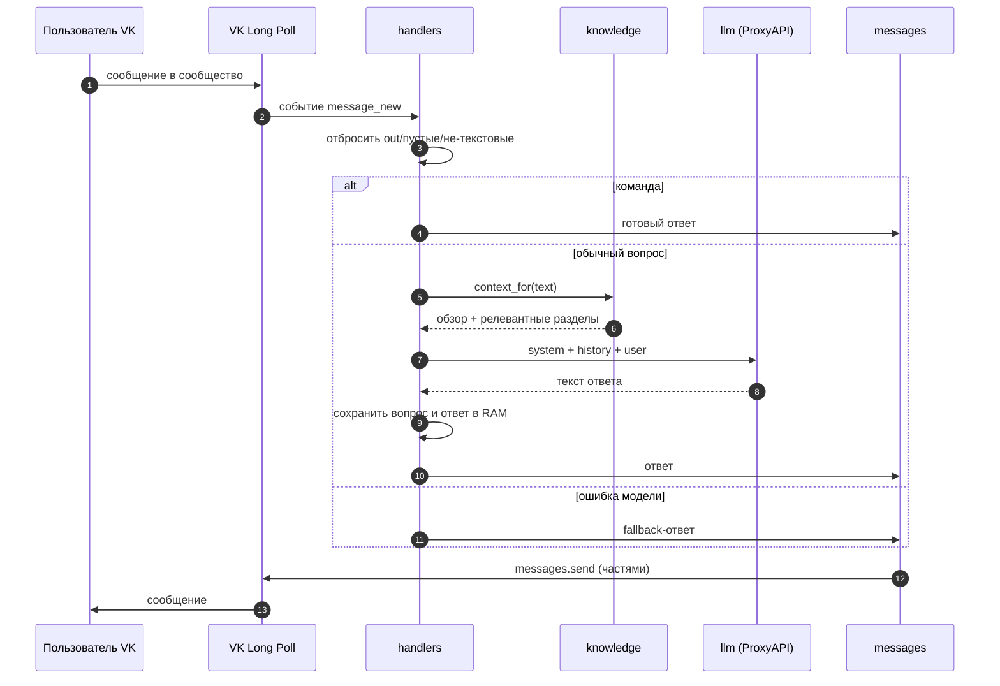

# Архитектура

Документ описывает, из каких частей состоит бот, как проходит запрос и какие компромиссы
заложены в дизайн.

## Общая схема



## Компоненты

| Модуль | Ответственность | Ключевые сущности |
| --- | --- | --- |
| `config.py` | Чтение `.env`, проверка типов и диапазонов, пути к ресурсам | `Settings`, `load_settings`, `ConfigurationError` |
| `knowledge.py` | Поиск по Markdown-базе, сборка системного сообщения | `KnowledgeBase`, `build_system_prompt`, `load_text_file` |
| `history.py` | История диалогов в памяти с TTL и вытеснением | `ConversationStore`, `UserState` |
| `llm.py` | Запрос к OpenAI-совместимому API через ProxyAPI | `ProxyAnswerClient` |
| `messages.py` | Команды, тексты, определение адресата, отправка и разбивка | `command_reply`, `split_for_vk`, `send_reply` |
| `handlers.py` | Сценарий обработки одного события | `process_event` |
| `app.py` | Логирование, подключение к VK, цикл Long Poll | `run`, `main`, `configure_logging` |

Зависимости направлены «вниз»: `app → handlers → {knowledge, llm, messages, history} → config`.
Обратных зависимостей нет, поэтому каждый модуль тестируется отдельно.

## Почему так

### ProxyAPI вместо прямого OpenAI

Из России прямой доступ к OpenAI API ограничен. ProxyAPI предоставляет
OpenAI-совместимый эндпоинт `https://api.proxyapi.ru/openai/v1`, поэтому код работает
с официальным SDK `openai` без вендорских костылей: достаточно поменять `base_url`
и ключ. Замена провайдера — это правка одной константы в `llm.py`.

### RAG «на минималках» вместо векторной базы

База знаний небольшая и структурированная, поэтому полноценные эмбеддинги и векторное
хранилище избыточны. Вместо этого:

1. Markdown делится на разделы по заголовкам (`#`, `##`, …).
2. Запрос и разделы токенизируются; стоп-слова отбрасываются.
3. Работают синонимы предметной области: `ии ↔ ai ↔ нейросети`, `вайб ↔ vibe ↔ claude`.
4. Совпадения считаются по префиксам от 4 символов, что грубо учитывает словоформы
   русского языка без морфологического анализатора.
5. Всегда добавляется обзорный раздел, затем до четырёх самых релевантных.

Такой подход детерминирован, объясним, не требует сети и легко тестируется.
Ограничение — качество поиска на сложных формулировках; в roadmap есть переход на эмбеддинги.

### История в оперативной памяти

Для консультации достаточно короткого контекста, а хранить переписку на диске —
значит брать на себя обязательства по персональным данным. Поэтому:

- `deque(maxlen=N)` хранит только последние N сообщений;
- запись старше `HISTORY_TTL_SECONDS` удаляется;
- при превышении `MAX_IN_MEMORY_USERS` вытесняются самые старые пользователи;
- при перезапуске история теряется — это осознанный компромисс.

### Fallback вместо исключения

Если ProxyAPI недоступен, таймаут или вернул пустой ответ, пользователь получает
вежливый `FALLBACK_REPLY`, а в лог пишется только тип ошибки. Бот продолжает работу:
цикл Long Poll переподключается после сетевых сбоев с паузой 5 секунд.

### Разбивка длинных ответов

ВКонтакте ограничивает длину сообщения. `split_for_vk` ищет ближайший перенос строки
или пробел во второй половине лимита, чтобы не рвать слова; остаток отправляется
следующим сообщением с новым `random_id`.

## Поток данных

```text
.env ──► load_settings ──► Settings ──┬──► ProxyAnswerClient
                                      ├──► ConversationStore
                                      ├──► KnowledgeBase.from_file(data/knowledge_base.md)
                                      └──► handlers.process_event

prompts/alina_system_prompt.md ──► load_text_file ──► build_system_prompt
```

## Обработка ошибок

| Ситуация | Поведение |
| --- | --- |
| Не заданы обязательные переменные | Понятная ошибка в лог, выход с кодом `1`, сеть не трогается |
| Некорректный `VK_GROUP_ID` или диапазон настроек | `ConfigurationError` до подключения к VK |
| Нет файла базы знаний или промпта | `ConfigurationError` с именем файла |
| Ошибка/таймаут ProxyAPI | Fallback-ответ, история сохраняется, бот жив |
| Ошибка `messages.send` | Запись в лог, цикл не падает |
| Обрыв Long Poll | Пересоздание `VkBotLongPoll`, пауза 5 секунд |
| `Ctrl+C` | Корректный выход с кодом `0` |

## Границы и точки расширения

- **Новый провайдер LLM** — заменить `PROXY_API_BASE_URL`/модель или реализовать
  альтернативу `ProxyAnswerClient.complete`.
- **Новая база знаний** — указать `KNOWLEDGE_BASE_PATH` на другой Markdown-файл.
- **Другой канал** — `handlers.process_event` не зависит от VK, кроме проверки типа события;
  транспорт можно заменить, сохранив `ConversationStore` и `ProxyAnswerClient`.
- **Внешнее хранилище истории** — заменить `ConversationStore` реализацией с тем же
  интерфейсом (`get_history`, `append`, `clear`).
